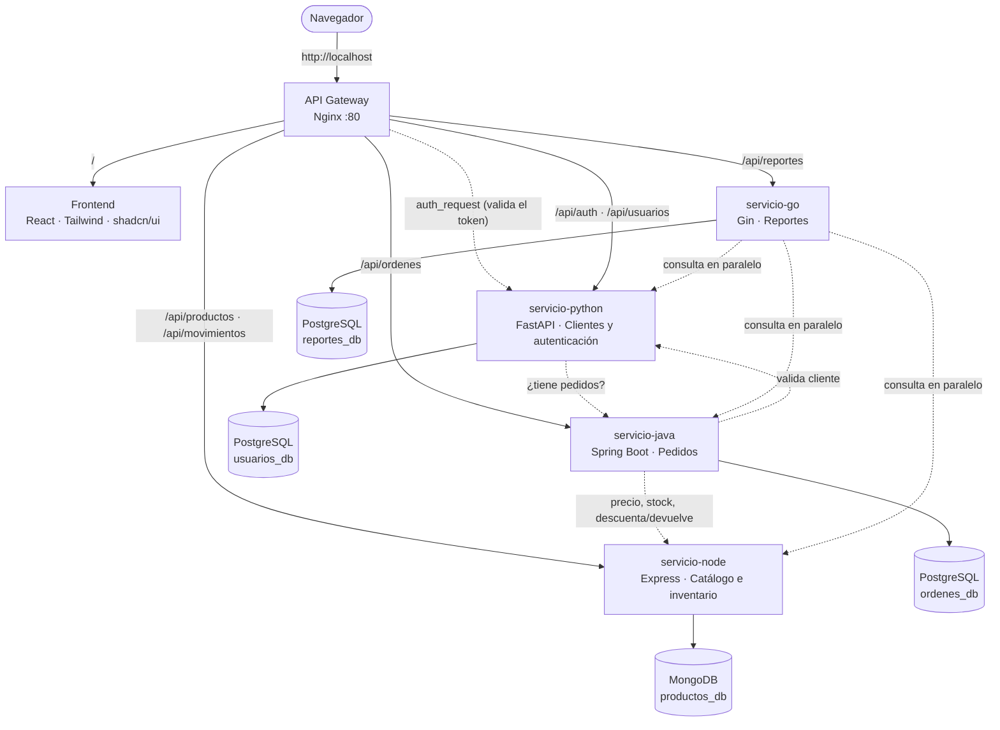

# 🛒 MercaUJAP: sistema de gestión comercial con microservicios

**Proyecto Final · LPR07304 Lenguajes de Programación · Universidad José Antonio Páez**

MercaUJAP es el panel de gestión de una **tienda de tecnología**. El personal inicia sesión y desde el navegador puede:

- 🧾 **Registrar pedidos** y llevarlos por su ciclo de vida: *pendiente → pagado → enviado → entregado* (o *cancelado*). Cada cambio queda en un historial. Se calcula el IVA (16 %) y se imprime la nota de entrega.
- 📦 Administrar el **catálogo**: precios, costos, márgenes y stock mínimo. Cada entrada, salida o ajuste de inventario queda registrado (**kardex**).
- 👥 Gestionar **clientes** (cédula/RIF, contacto, historial de compras).
- 📈 Ver un **panel con indicadores**: ventas, ganancia bruta, ticket promedio y comparación con el período anterior, más gráficos por día, por estado y por categoría. También genera **reportes** que se guardan y se descargan en CSV (Excel).
- 🔐 Controlar el acceso con **inicio de sesión y roles**: el *administrador* puede todo y el *vendedor* no puede eliminar registros.

Cada parte del sistema es un **microservicio** independiente escrito en un lenguaje distinto, con su propio contenedor Docker y su propia base de datos. Todo se levanta con **un solo comando**.

> 📘 ¿Recién empiezas con programación o Docker? Lee la **[GUÍA para entender el proyecto](GUIA.md)**, que explica todo paso a paso.


---

## 🚀 Cómo ejecutarlo

**Requisito:** tener [Docker Desktop](https://www.docker.com/products/docker-desktop/) instalado y abierto. No hace falta instalar Python, Node, Java ni Go, porque todo se compila dentro de Docker.

```bash
git clone https://github.com/stvnalc/mercaujap-microservicios.git
cd mercaujap-microservicios
docker compose up --build
```

La primera vez tarda unos minutos porque descarga imágenes y compila Java, Go y React. Cuando `docker compose ps` muestre los servicios como `healthy`, abre **http://localhost** e inicia sesión:

| Rol | Correo | Contraseña |
|---|---|---|
| Administrador | `admin@mercaujap.com` | `admin123` |
| Vendedor | `vendedor@mercaujap.com` | `vendedor123` |

> El sistema arranca con **datos de ejemplo**: 12 clientes, 16 productos y unos 80 pedidos repartidos en los últimos 60 días, para que el panel y los reportes tengan información desde el primer momento. Se desactiva con `DEMO_DATA=false` en el `.env`.

| Qué | URL |
|---|---|
| 🖥️ **Aplicación (vía API Gateway)** | http://localhost |
| Swagger de Python (documentación automática) | http://localhost:8001/docs |
| Servicios directos (sin gateway, solo para pruebas) | :8001 Python · :8002 Node · :8003 Java · :8004 Go |

```bash
docker compose ps                      # estado de cada contenedor (healthy = listo)
docker compose logs -f servicio-java   # logs de un servicio
docker compose down                    # apagar (los datos se conservan)
docker compose down -v                 # apagar y BORRAR los datos (vuelve a cargar los de ejemplo)
```

---

## 🧩 Arquitectura



Versión en texto (por si el diagrama de arriba no se dibuja):

```
                            Navegador (personal de la tienda)
                                          │ http://localhost
                                          ▼
     ┌────────────────────────────────────────────────────────────────────────┐
     │ API GATEWAY · Nginx :80   (enrutamiento · auth_request · límite login) │
     └─────┬─────────────┬──────────────┬──────────────┬──────────────┬───────┘
           │ /           │ /api/auth    │ /api/        │ /api/        │ /api/
           │             │ /api/usuarios│ productos    │ ordenes      │ reportes
           ▼             ▼              ▼              ▼              ▼
     ┌───────────┐ ┌────────────┐ ┌────────────┐ ┌────────────┐ ┌────────────┐
     │ FRONTEND  │ │ PYTHON     │ │ NODE       │ │ JAVA       │ │ GO         │
     │ React +   │ │ FastAPI    │ │ Express    │ │ Spring     │ │ Gin        │
     │ shadcn/ui │ │ clientes,  │ │ catálogo,  │ │ pedidos,   │ │ indicado-  │
     │           │ │ login JWT  │ │ inventario │ │ estados    │ │ res y CSV  │
     └───────────┘ └─────┬──────┘ └─────┬──────┘ └─────┬──────┘ └─────┬──────┘
                         ▼              ▼              ▼              ▼
                    PostgreSQL       MongoDB       PostgreSQL     PostgreSQL
                    usuarios_db    productos_db    ordenes_db     reportes_db

  Llamadas entre servicios:  Java → Python (valida cliente) · Java → Node (precio y stock)
                             Python → Java (¿tiene pedidos?) · Go → Python, Node y Java
                             Gateway → Python (valida el token en cada petición)
```

### 📋 Servicios

| Servicio | Lenguaje / Framework | Puerto | Base de datos · ORM | Responsabilidad |
|---|---|---|---|---|
| **gateway** | Nginx | `80` | — | Punto de entrada único, **autenticación centralizada** (`auth_request`), límite de intentos de login, cabeceras de seguridad y errores en JSON |
| **frontend** | React 19 · Vite · Tailwind CSS 4 · **shadcn/ui** · Recharts | `3000` | — | Panel de gestión (SPA) |
| **servicio-python** | Python 3.12 · FastAPI | `8001` | PostgreSQL · **SQLAlchemy** | Clientes, cuentas del personal, roles, **login con JWT** y contraseñas con hash PBKDF2 |
| **servicio-node** | Node.js 20 · Express | `8002` | MongoDB · **Mongoose** | Catálogo, SKU, costos/márgenes, stock atómico y **movimientos de inventario** |
| **servicio-java** | Java 21 · Spring Boot 3.5 | `8003` | PostgreSQL · **Spring Data JPA** | Pedidos, **máquina de estados**, historial, IVA, métodos de pago y compensación de stock |
| **servicio-go** | Go 1.25 · Gin | `8004` | PostgreSQL · **GORM** | Indicadores en vivo, reportes guardados y **exportación CSV** |
| **postgres** | PostgreSQL 16 | interno | `usuarios_db`, `ordenes_db`, `reportes_db` | Una base de datos por servicio |
| **mongodb** | MongoDB 7 | interno | `productos_db` | Colecciones `productos` y `movimientos` |

### 🔗 Comunicación entre microservicios

| Quién llama | A quién | Para qué |
|---|---|---|
| **Gateway** | Python `GET /auth/verificar` | En **cada** petición protegida: valida el token y el rol, y pasa el usuario a los servicios en cabeceras `X-Usuario-*` |
| Java (pedidos) | Python `GET /usuarios/{id}` | Verificar que el cliente existe y está activo, y copiar sus datos al pedido |
| Java (pedidos) | Node `GET /productos/{id}` | Tomar el precio real y revisar el stock |
| Java (pedidos) | Node `PATCH /productos/{id}/stock` | Descontar stock al vender y devolverlo al cancelar (queda como movimiento `Venta PED-000123`) |
| Python (clientes) | Java `GET /ordenes?usuarioId=` | Impedir que se elimine un cliente que tiene pedidos |
| Go (reportes) | Python, Node y Java **en paralelo** (goroutines) | Calcular los indicadores y reportes |

**Compensación (patrón saga):** cada servicio tiene su propia base de datos, así que no existe una transacción global. Si al crear un pedido falla el descuento del segundo producto, Java **devuelve el stock** que ya había descontado y borra el pedido.

**Tolerancia a fallos:** si un servicio se cae, el resto sigue funcionando. El gateway responde en JSON y el panel muestra qué módulo no respondió.

---

## 🔐 Seguridad y reglas de negocio

- **Autenticación centralizada en el gateway:** Nginx usa `auth_request` para preguntarle a Python si el token JWT es válido antes de dejar pasar la petición. Los demás servicios no manejan tokens. Las cabeceras `X-Usuario-*` las escribe siempre Nginx, así que el cliente no puede falsificarlas.
- **Roles:** solo el **administrador** puede eliminar registros (lo aplica el gateway) y gestionar cuentas del personal (lo aplica Python).
- Contraseñas con **hash PBKDF2-SHA256** y sal. Límite de **10 intentos de login por minuto** por IP.
- **Máquina de estados** de pedidos: no se puede pasar de *pendiente* a *entregado*, ni modificar un pedido *entregado* o *cancelado*. Solo se eliminan pedidos cancelados.
- **Stock atómico:** Node descuenta con `findOneAndUpdate({stock: {$gte: n}}, {$inc: {stock: -n}})`, así que dos ventas simultáneas no pueden dejar el stock negativo.
- Validación de datos en todos los servicios, con **mensajes de error en español**.
- Pruebas unitarias del cálculo de reportes en Go (`go test`), que se ejecutan al construir la imagen.

---

## 🧪 Probar la API desde la terminal

Todas las rutas `/api/*` (salvo el login y los health checks) requieren el token:

```bash
# 1. Iniciar sesión y guardar el token
TOKEN=$(curl -s -X POST http://localhost/api/auth/login \
  -H "Content-Type: application/json" \
  -d '{"email":"admin@mercaujap.com","password":"admin123"}' | python3 -c "import sys,json;print(json.load(sys.stdin)['token'])")

# 2. Usarlo en las peticiones
curl -H "Authorization: Bearer $TOKEN" http://localhost/api/productos
curl -H "Authorization: Bearer $TOKEN" "http://localhost/api/ordenes?estado=PENDIENTE"
curl -H "Authorization: Bearer $TOKEN" "http://localhost/api/reportes/resumen?desde=2026-10-01&hasta=2026-10-31"

# Crear un pedido (Java llama a Python y a Node). Usa un _id real de /api/productos
curl -X POST http://localhost/api/ordenes -H "Authorization: Bearer $TOKEN" -H "Content-Type: application/json" \
  -d '{"usuarioId": 1, "metodoPago": "PAGO_MOVIL", "items": [{"productoId": "PEGA_AQUI_UN_ID", "cantidad": 2}]}'

# Sin token, el gateway responde 401
curl -i http://localhost/api/productos
```

<details>
<summary><b>Lista completa de endpoints</b></summary>

| Método | Ruta (vía gateway) | Servicio | Descripción |
|---|---|---|---|
| POST | `/api/auth/login` | Python | Inicia sesión, devuelve `{ token, usuario }` |
| GET | `/api/auth/me` | Python | Usuario del token |
| POST | `/api/auth/cambiar-password` | Python | Cambia la contraseña propia |
| GET | `/api/usuarios?q=&tipo=clientes\|personal&activo=` | Python | Lista con filtros |
| GET/PUT/DELETE | `/api/usuarios/{id}` | Python | Ver, editar o eliminar |
| POST | `/api/usuarios` | Python | Crear cliente o cuenta del personal |
| GET | `/api/productos?q=&categoria=&estado=bajo\|agotado&activo=` | Node | Catálogo con filtros |
| GET | `/api/productos/categorias` | Node | Categorías con valor de inventario |
| GET/PUT/DELETE | `/api/productos/{id}` | Node | Ver, editar o eliminar |
| POST | `/api/productos` | Node | Crear (el stock inicial queda como movimiento) |
| PATCH | `/api/productos/{id}/stock` | Node | Entrada/salida/ajuste `{ cantidad, motivo }` |
| GET | `/api/productos/{id}/movimientos` | Node | Kardex del producto |
| GET | `/api/movimientos?tipo=&q=` | Node | Movimientos de todo el inventario |
| GET | `/api/ordenes?estado=&usuarioId=&desde=&hasta=&q=` | Java | Pedidos con filtros |
| GET | `/api/ordenes/{id}` | Java | Pedido con items, historial y estados siguientes |
| POST | `/api/ordenes` | Java | Crear pedido |
| PATCH | `/api/ordenes/{id}/estado` | Java | `{ estado, nota }` según la máquina de estados |
| DELETE | `/api/ordenes/{id}` | Java | Eliminar (solo cancelados) |
| GET | `/api/reportes/resumen?desde=&hasta=` | Go | Indicadores en vivo |
| GET/POST | `/api/reportes` | Go | Historial / generar y guardar `{ titulo, desde, hasta }` |
| GET/DELETE | `/api/reportes/{id}` | Go | Ver o eliminar un reporte |
| GET | `/api/reportes/{id}/csv` | Go | Descargar en CSV |
| GET | `/api/health/{gateway\|python\|node\|java\|go}` | todos | Estado de cada servicio (público) |

</details>

---

## 📸 Capturas

| | |
|---|---|
| **Inicio de sesión**  | **Pedidos**  |
| **Detalle de pedido con historial**  | **Nuevo pedido (tema oscuro)**  |
| **Productos: stock y kardex**  | **Reporte guardado**  |

---

## ✅ Cumplimiento de la rúbrica

| Criterio (pts) | Dónde está |
|---|---|
| 4 microservicios, 1 por lenguaje (6) | `servicio-python/`, `servicio-node/`, `servicio-java/`, `servicio-go/` |
| Dockerfile + docker-compose.yml (4) | Un `Dockerfile` en cada microservicio y también en `frontend/`, `nginx/` y `database/` (compilación multi-etapa en Java, Go y React), más `docker-compose.yml` con *networks*, *healthchecks*, *depends_on* y *volumes* |
| BD SQL en mín. 2 servicios (3) | PostgreSQL en **3** servicios: Python (SQLAlchemy), Java (JPA) y Go (GORM) |
| BD NoSQL en mín. 1 servicio (2) | MongoDB en Node (Mongoose), con 2 colecciones |
| Frontend consumiendo las APIs (2) | `frontend/`: React + shadcn/ui, consume los 4 servicios a través del gateway |
| Comunicación entre microservicios (2) | Gateway → Python · Java → Python y Node · Python → Java · Go → Python, Node y Java |
| README con diagrama (1) | Este archivo |
| **BONUS** API Gateway Nginx (+2) | `nginx/nginx.conf`: enrutamiento, autenticación centralizada, rate limiting y errores JSON |

---

## 📁 Estructura del repositorio

```
.
├── docker-compose.yml        ← orquesta los 8 contenedores
├── .env.example              ← variables de entorno (copiar a .env si quieres cambiarlas)
├── README.md · GUIA.md
├── docs/capturas/            ← capturas de pantalla
├── database/                 ← init.sql (una BD por servicio) + Dockerfile
├── nginx/                    ← nginx.conf (API Gateway) + Dockerfile
├── frontend/                 ← React + Vite + Tailwind + shadcn/ui
│   └── src/
│       ├── components/ui/    ← componentes de shadcn/ui (botones, tablas, diálogos…)
│       ├── components/       ← barra lateral, buscador, tablas, insignias…
│       ├── pages/            ← panel, pedidos, productos, clientes, reportes, equipo
│       └── lib/              ← api.js (llamadas al gateway), auth, formatos
├── servicio-python/          ← main.py, seguridad.py, models.py, schemas.py, database.py
├── servicio-node/            ← index.js, producto.model.js, movimiento.model.js, datos-iniciales.js
├── servicio-java/            ← controller/, service/, model/, repository/, client/, demo/
└── servicio-go/              ← main.go, reportes.go, csv.go, clientes.go, modelos.go, reportes_test.go
```
