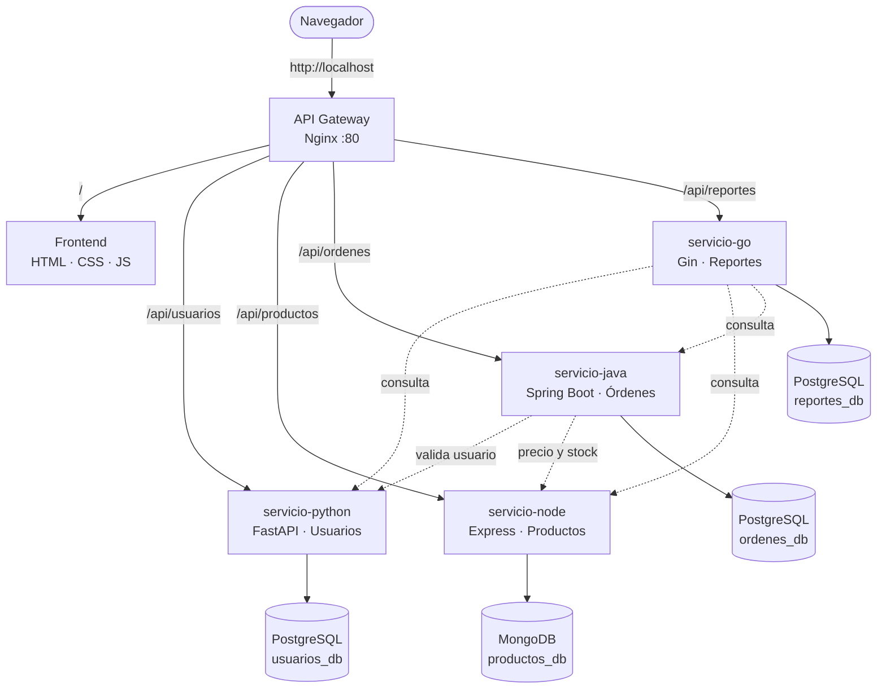
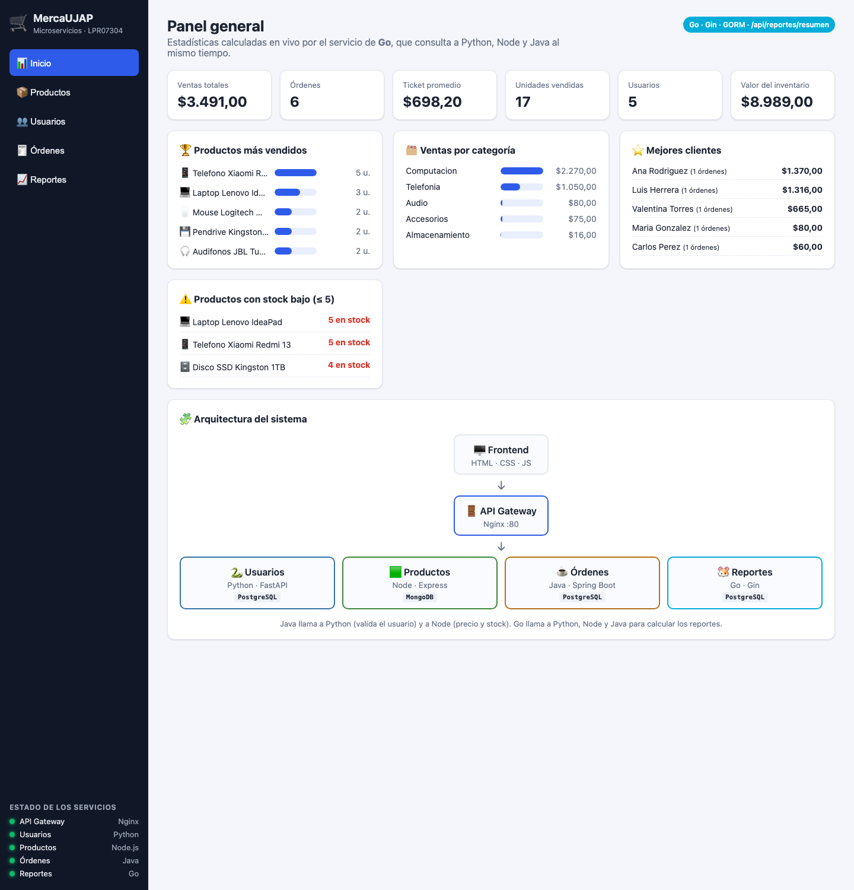
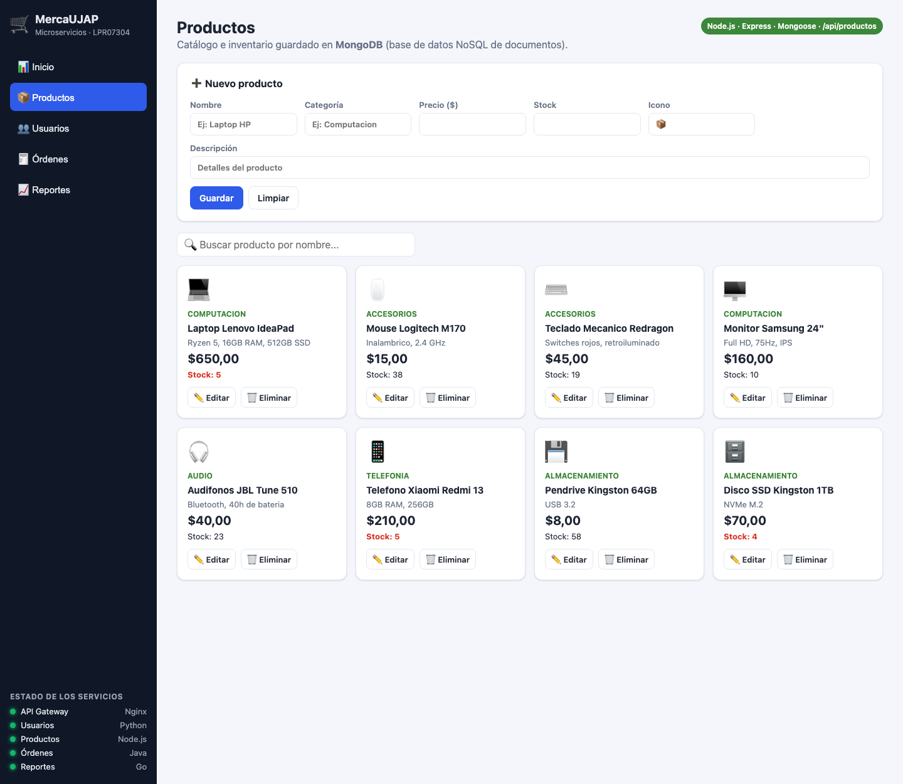
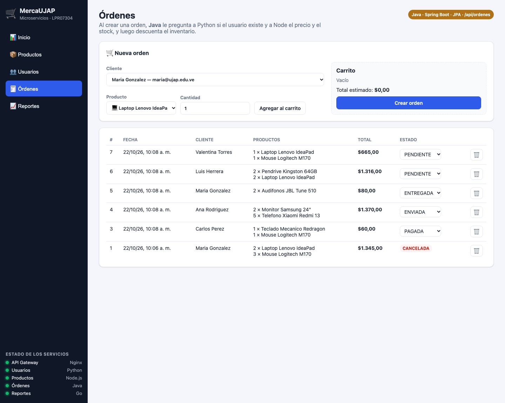
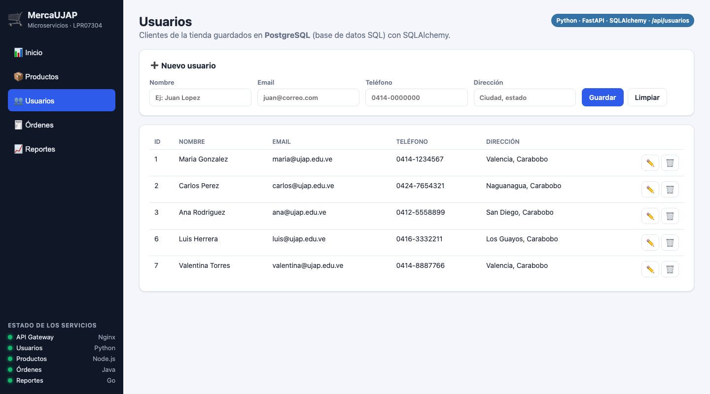
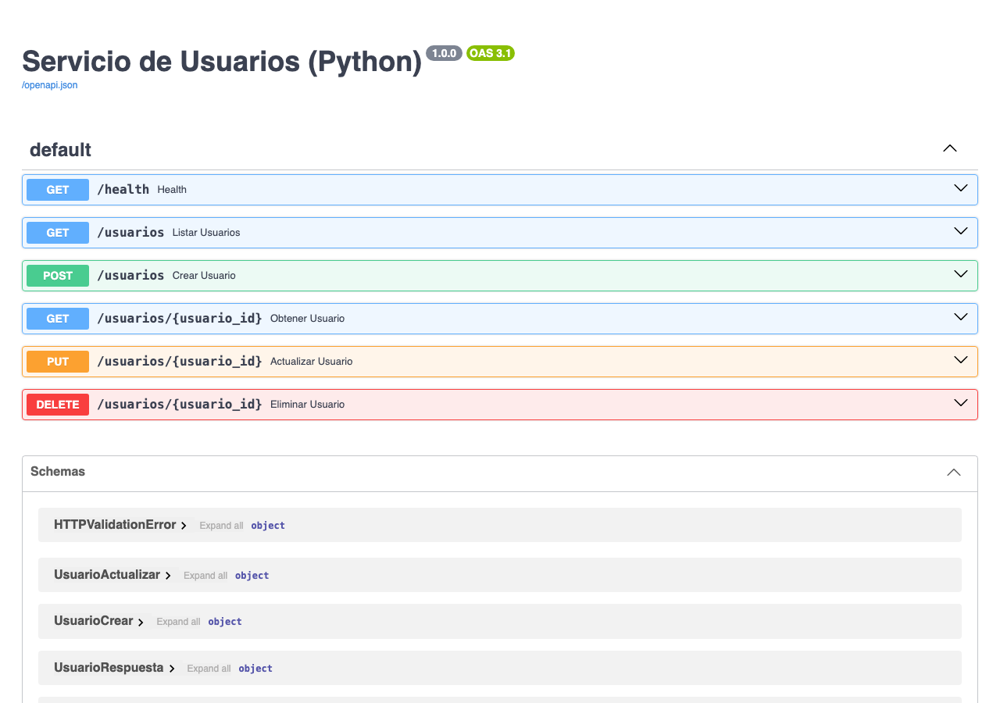
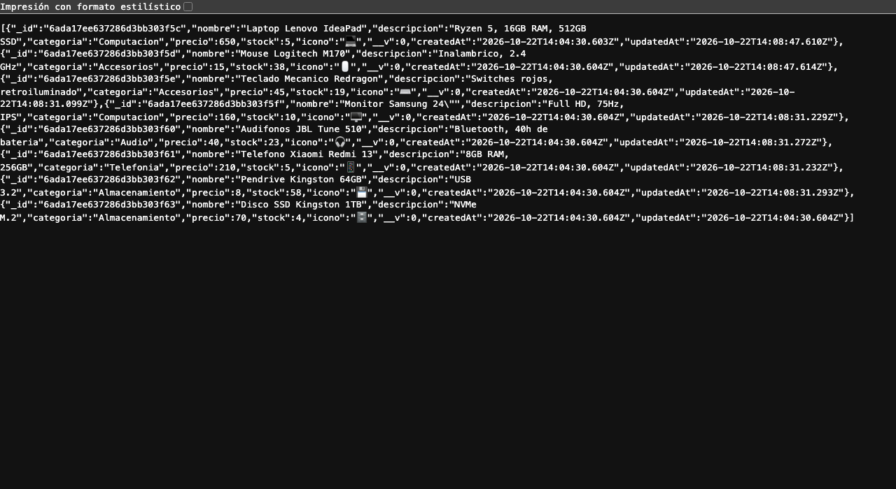

# 🛒 MercaUJAP: sistema de pedidos con microservicios

**Proyecto Final · LPR07304 Lenguajes de Programación · Universidad José Antonio Páez**

MercaUJAP es el sistema web de una **tienda de tecnología**. Desde el navegador se puede:

- 👥 Registrar **clientes** (usuarios).
- 📦 Administrar el **catálogo de productos** y su inventario (stock).
- 🧾 Crear **órdenes de compra**. Al crearla, el sistema verifica que el cliente exista, toma el precio real de cada producto, revisa que haya stock y lo descuenta.
- 📈 Ver **estadísticas en vivo** (ventas, productos más vendidos, mejores clientes, stock bajo) y guardar **reportes históricos**.

Cada parte del sistema es un **microservicio** independiente escrito en un lenguaje distinto y corre en su **propio contenedor Docker**. Todo se levanta con **un solo comando**.

> 📘 ¿Recién empiezas con programación o Docker? Lee la **[GUÍA para entender el proyecto](GUIA.md)**: explica todo paso a paso.

---

## 🧩 Arquitectura

```
                         ┌──────────────────────────────┐
                         │   Navegador (usuario final)  │
                         └──────────────┬───────────────┘
                                        │ http://localhost
                         ┌──────────────▼───────────────┐
                         │   API GATEWAY · Nginx :80    │  ← punto de entrada único (BONUS)
                         └──┬──────┬──────┬──────┬──────┬┘
                /           │      │      │      │      │
        ┌───────▼──────┐    │      │      │      │      │
        │  FRONTEND    │    │      │      │      │      │
        │ HTML/CSS/JS  │    │      │      │      │      │
        │ (Nginx :3000)│    │      │      │      │      │
        └──────────────┘    │      │      │      │      │
              /api/usuarios │      │      │      │ /api/reportes
          ┌─────────────────▼┐  ┌──▼──────┴───┐ ┌▼─────────────┐ ┌▼──────────────┐
          │ servicio-python  │  │servicio-node│ │servicio-java │ │ servicio-go   │
          │ FastAPI  :8001   │  │Express :8002│ │Spring  :8003 │ │ Gin    :8004  │
          │ USUARIOS         │  │PRODUCTOS    │ │ÓRDENES       │ │ REPORTES      │
          └────────┬─────────┘  └──────┬──────┘ └──────┬───────┘ └───────┬───────┘
                   │  ▲                │  ▲            │                 │
                   │  └── valida ──────┼──┼────────────┤                 │
                   │      usuario      │  └ precio y ──┘                 │
                   │                   │    stock                        │
                   │  ◄────────────────┴─────── consulta a los 3 ────────┤
                   │                                                     │
          ┌────────▼───────────────────────────────────────────┐ ┌───────▼──────┐
          │ PostgreSQL 16 (SQL)                                │ │ MongoDB 7    │
          │  usuarios_db (Python) · ordenes_db (Java) ·        │ │ (NoSQL)      │
          │  reportes_db (Go)                                  │ │ productos_db │
          └────────────────────────────────────────────────────┘ └──────────────┘
```

El mismo diagrama en Mermaid (GitHub lo dibuja solo):



---

## 📋 Servicios

| Servicio | Lenguaje / Framework | Puerto (host → contenedor) | Base de datos · ORM | Endpoints principales |
|---|---|---|---|---|
| **gateway** | Nginx | `80 → 80` | — | `/` · `/api/usuarios` · `/api/productos` · `/api/ordenes` · `/api/reportes` · `/api/health/*` |
| **frontend** | HTML + CSS + JavaScript (Nginx) | `3000 → 80` | — | Interfaz web |
| **servicio-python** | Python 3.12 · FastAPI | `8001 → 8000` | PostgreSQL · **SQLAlchemy** | `GET/POST /usuarios` · `GET/PUT/DELETE /usuarios/{id}` · `GET /health` |
| **servicio-node** | Node.js 20 · Express | `8002 → 3000` | MongoDB · **Mongoose** | `GET/POST /productos` · `GET/PUT/DELETE /productos/:id` · `PATCH /productos/:id/stock` · `GET /health` |
| **servicio-java** | Java 21 · Spring Boot 3 | `8003 → 8080` | PostgreSQL · **Spring Data JPA** | `GET/POST /ordenes` · `GET/DELETE /ordenes/{id}` · `PATCH /ordenes/{id}/estado` · `GET /health` |
| **servicio-go** | Go 1.25 · Gin | `8004 → 8080` | PostgreSQL · **GORM** | `GET /reportes/resumen` · `GET/POST /reportes` · `GET/DELETE /reportes/:id` · `GET /health` |
| **postgres** | PostgreSQL 16 | (interno) | 3 bases: `usuarios_db`, `ordenes_db`, `reportes_db` | — |
| **mongodb** | MongoDB 7 | (interno) | `productos_db` | — |

### 🔗 Comunicación entre microservicios

| Quién llama | A quién | Para qué |
|---|---|---|
| Java (órdenes) | Python `GET /usuarios/{id}` | Validar que el cliente existe y tomar su nombre |
| Java (órdenes) | Node `GET /productos/{id}` | Tomar el precio real y revisar el stock |
| Java (órdenes) | Node `PATCH /productos/{id}/stock` | Descontar stock al comprar / devolverlo al cancelar |
| Go (reportes) | Python, Node y Java (en paralelo con *goroutines*) | Calcular las estadísticas del negocio |

Si algo falla a mitad de una orden (por ejemplo, se acaba el stock del segundo producto), Java **devuelve el stock** que ya había descontado. Como cada servicio tiene su propia base de datos, no existe una transacción global, así que se usa esta *compensación*.

---

## 🚀 Cómo ejecutarlo

**Requisito:** tener [Docker Desktop](https://www.docker.com/products/docker-desktop/) instalado y abierto. No hace falta instalar Python, Node, Java ni Go: todo se compila dentro de Docker.

```bash
git clone https://github.com/stvnalc/mercaujap-microservicios.git
cd mercaujap-microservicios
cp .env.example .env          # opcional: si no lo haces se usan los mismos valores por defecto
docker compose up --build
```

La primera vez tarda unos minutos porque descarga imágenes y compila Java y Go. Cuando en la consola deje de aparecer texto nuevo, abre:

| Qué | URL |
|---|---|
| 🖥️ **Aplicación (vía API Gateway)** | http://localhost |
| Frontend directo | http://localhost:3000 |
| Swagger de Python (documentación automática) | http://localhost:8001/docs |
| Productos (Node) directo | http://localhost:8002/productos |
| Órdenes (Java) directo | http://localhost:8003/ordenes |
| Resumen (Go) directo | http://localhost:8004/reportes/resumen |

Otros comandos útiles:

```bash
docker compose ps                 # ver el estado de cada contenedor (healthy = listo)
docker compose logs -f servicio-java   # ver los logs de un servicio
docker compose down               # apagar todo (los datos se conservan en los volúmenes)
docker compose down -v            # apagar y BORRAR los datos (empezar de cero)
```

> El sistema arranca con **3 usuarios y 8 productos de ejemplo** para que se pueda probar de inmediato.

### Probar la API desde la terminal

```bash
# Listar usuarios (Python) a través del gateway
curl http://localhost/api/usuarios

# Listar productos (Node)
curl http://localhost/api/productos

# Crear una orden (Java llama a Python y a Node). Cambia el productoId por uno real.
curl -X POST http://localhost/api/ordenes \
  -H "Content-Type: application/json" \
  -d '{"usuarioId": 1, "items": [{"productoId": "PEGA_AQUI_UN_ID", "cantidad": 2}]}'

# Estadísticas en vivo (Go consulta a los otros 3)
curl http://localhost/api/reportes/resumen
```

---

## 📸 Capturas

**Panel general (datos calculados por Go a partir de Python, Node y Java)**


**Productos (Node.js + MongoDB)**


**Órdenes (Java + PostgreSQL)**


**Usuarios (Python + PostgreSQL)**


**Servicios respondiendo directamente: Swagger de FastAPI (Python) y JSON de Node**



---

## ✅ Cumplimiento de la rúbrica

| Criterio (pts) | Dónde está |
|---|---|
| 4 microservicios, 1 por lenguaje (6) | `servicio-python/`, `servicio-node/`, `servicio-java/`, `servicio-go/` |
| Dockerfile + docker-compose.yml (4) | Un `Dockerfile` en cada microservicio y también en `frontend/`, `nginx/` y `database/`, más `docker-compose.yml` con *networks*, *healthcheck*, *depends_on* y *volumes* |
| BD SQL en mín. 2 servicios (3) | PostgreSQL en **3** servicios: Python (SQLAlchemy), Java (JPA) y Go (GORM) |
| BD NoSQL en mín. 1 servicio (2) | MongoDB en Node (Mongoose) |
| Frontend consumiendo las APIs (2) | `frontend/`: consume los 4 servicios |
| Comunicación entre microservicios (2) | Java → Python y Node · Go → Python, Node y Java |
| README con diagrama (1) | Este archivo |
| **BONUS** API Gateway Nginx (+2) | `nginx/nginx.conf` + servicio `gateway` en el compose |

Extras: variables de entorno con `.env` (y `.env.example`), `.gitignore`, datos de ejemplo automáticos, health checks visibles en el frontend, manejo de errores en JSON y compensación de stock.

---

## 📁 Estructura del repositorio

```
.
├── docker-compose.yml        ← orquesta los 8 contenedores
├── .env.example              ← variables de entorno (copiar a .env)
├── .gitignore
├── README.md                 ← este archivo
├── GUIA.md                   ← guía paso a paso para entender el proyecto
├── database/                 ← init.sql (una BD por servicio) + Dockerfile de PostgreSQL
├── nginx/                    ← nginx.conf (API Gateway) + Dockerfile
├── frontend/                 ← index.html, style.css, app.js, nginx.conf, Dockerfile
├── servicio-python/          ← main.py, database.py, models.py, schemas.py, requirements.txt, Dockerfile
├── servicio-node/            ← index.js, producto.model.js, package.json, Dockerfile
├── servicio-java/            ← pom.xml, src/main/java/com/ujap/ordenes/..., Dockerfile
└── servicio-go/              ← main.go, clientes.go, reportes.go, modelos.go, go.mod, Dockerfile
```
