# MercaUJAP · Sistema de gestión comercial basado en microservicios

**Proyecto final · LPR07304 Lenguajes de Programación · Universidad José Antonio Páez**

| Integrantes |
|---|
| Steven Alcalá |
| Jorge Fattal |
| Eyleen Berrio |
| Ricardo Elbazi |

MercaUJAP es un panel de gestión para una tienda de tecnología. El sistema está dividido en **cuatro microservicios**, cada uno escrito en un lenguaje distinto y con su propia base de datos. Un **API Gateway** con Nginx los une detrás de un único punto de entrada, y un **frontend** en React los consume. Todo se despliega con Docker Compose usando un solo comando.

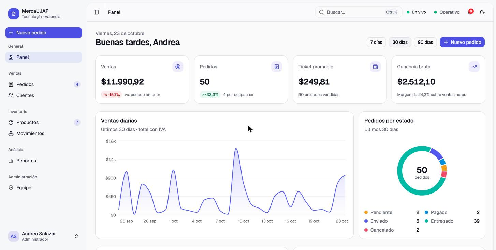

---

## Contenido

1. [Funcionalidades](#funcionalidades)
2. [Arquitectura](#arquitectura)
3. [Ejecución](#ejecución)
4. [Seguridad y reglas de negocio](#seguridad-y-reglas-de-negocio)
5. [API](#api)
6. [Capturas](#capturas)
7. [Requisitos del proyecto](#requisitos-del-proyecto)
8. [Estructura del repositorio](#estructura-del-repositorio)

---

## Funcionalidades

- **Pedidos con ciclo de vida.** Cada pedido sigue los estados *pendiente → pagado → enviado → entregado* (o *cancelado*), controlados por una máquina de estados. Los datos de cada paso se guardan en campos propios:
  - al pagar: método de pago, **banco** y **número de referencia** (solo dígitos);
  - al despachar: **empresa de envío** (MRW, Zoom, Tealca, Domesa o Liberty Express) y **número de guía**;
  - al entregar: quién lo recibió.

  El IVA (16 %) se calcula en el servidor, cada cambio queda en un historial con fecha y usuario, y se puede imprimir la nota de entrega.
- **Formas de entrega.** Retiro en tienda, delivery o envío nacional. En el retiro en tienda se omite el paso *enviado*.
- **Catálogo e inventario.** Precios, costos, márgenes, SKU y stock mínimo. Cada entrada, salida o ajuste queda registrado en un **kardex**.
- **Clientes.** Cédula o RIF, datos de contacto e historial de compras.
- **Indicadores y reportes.** Ventas, ganancia bruta, ticket promedio y comparación con el período anterior, con gráficos por día, por estado y por categoría. Los reportes se guardan y se exportan a CSV.
- **Colaboración en tiempo real (WebSocket).** Cuando un usuario crea o modifica un registro, la pantalla de los demás se actualiza sin recargar: aparece un aviso con el autor del cambio y la fila afectada se resalta. El encabezado muestra quién está conectado.
- **Formularios integrados.** La creación y la edición se hacen dentro de la misma página (en la parte superior de la lista o desplegadas en la fila), sin ventanas superpuestas. Si otra persona modifica el mismo registro mientras se edita, el formulario lo indica.
- **Autenticación y roles.** El *administrador* tiene acceso completo; el *vendedor* no puede eliminar registros ni gestionar cuentas del personal.

---

## Arquitectura

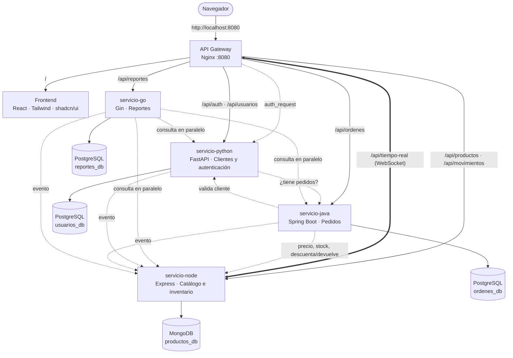

<details>
<summary>Versión en texto del diagrama</summary>

```
                                  Navegador
                                      │ http://localhost:8080
                                      ▼
     ┌────────────────────────────────────────────────────────────────────────┐
     │ API GATEWAY · Nginx :8080 (enrutamiento · auth_request · WebSocket)    │
     └─────┬─────────────┬──────────────┬──────────────┬──────────────┬───────┘
           │ /           │ /api/auth    │ /api/        │ /api/        │ /api/
           │ :80         │ /api/usuarios│ productos    │ ordenes      │ reportes
           │             │ :8000        │ tiempo-real  │ :8080        │ :8080
           │             │              │ :3000        │              │
           ▼             ▼              ▼              ▼              ▼
     ┌───────────┐ ┌────────────┐ ┌────────────┐ ┌────────────┐ ┌────────────┐
     │ FRONTEND  │ │ PYTHON     │ │ NODE       │ │ JAVA       │ │ GO         │
     │ React +   │ │ FastAPI    │ │ Express    │ │ Spring     │ │ Gin        │
     │ shadcn/ui │ │ clientes,  │ │ catálogo,  │ │ pedidos,   │ │ indicado-  │
     │           │ │ login JWT  │ │ inventario │ │ estados    │ │ res y CSV  │
     │           │ │            │ │ WebSocket  │ │            │ │            │
     └───────────┘ └─────┬──────┘ └─────┬──────┘ └─────┬──────┘ └─────┬──────┘
                         ▼              ▼              ▼              ▼
                    PostgreSQL       MongoDB       PostgreSQL     PostgreSQL
                    usuarios_db    productos_db    ordenes_db     reportes_db

  Llamadas entre servicios:  Java → Python (valida cliente) · Java → Node (precio y stock)
                             Python → Java (¿tiene pedidos?) · Go → Python, Node y Java
                             Gateway → Python (valida el token en cada petición)
  Tiempo real:               Python, Java y Go → Node (POST /interno/eventos)
                             Node → navegadores conectados (WebSocket)
```

</details>

### Servicios

| Servicio | Tecnología | Puerto | Base de datos · ORM | Responsabilidad |
|---|---|---|---|---|
| **gateway** | Nginx | **8080** (único publicado) | — | Punto de entrada único, autenticación centralizada (`auth_request`), proxy WebSocket, límite de intentos de login, cabeceras de seguridad y errores en JSON |
| **frontend** | React 19 · Vite · Tailwind CSS 4 · shadcn/ui · Recharts | 80 (interno) | — | Aplicación web (SPA) |
| **servicio-python** | Python 3.12 · FastAPI | 8000 (interno) | PostgreSQL · SQLAlchemy | Clientes, cuentas del personal, roles, login con JWT y contraseñas con hash PBKDF2 |
| **servicio-node** | Node.js 20 · Express · ws | 3000 (interno) | MongoDB · Mongoose | Catálogo, stock atómico, movimientos de inventario y canal de tiempo real |
| **servicio-java** | Java 21 · Spring Boot 3.5 | 8080 (interno) | PostgreSQL · Spring Data JPA | Pedidos, máquina de estados, pagos, envíos, historial, IVA y compensación de stock |
| **servicio-go** | Go 1.25 · Gin | 8080 (interno) | PostgreSQL · GORM | Indicadores, reportes guardados y exportación CSV |
| **postgres** | PostgreSQL 16 | interno | `usuarios_db`, `ordenes_db`, `reportes_db` | Una base de datos por servicio |
| **mongodb** | MongoDB 7 | interno | `productos_db` | Colecciones `productos` y `movimientos` |

Solo el gateway publica un puerto en el equipo anfitrión. Los demás contenedores se comunican por las redes internas de Docker (`frontend` y `backend`), y las bases de datos únicamente están en la red `backend`.

### Comunicación entre servicios

| Origen | Destino | Propósito |
|---|---|---|
| Gateway | Python `GET /auth/verificar` | En cada petición protegida: valida el token y el rol, y entrega el usuario a los servicios en las cabeceras `X-Usuario-*` |
| Java | Python `GET /usuarios/{id}` | Verificar que el cliente existe y está activo, y copiar sus datos al pedido |
| Java | Node `GET /productos/{id}` | Obtener el precio vigente y revisar el stock |
| Java | Node `PATCH /productos/{id}/stock` | Descontar el stock al vender y devolverlo al cancelar (queda como movimiento `Venta PED-000123`) |
| Python | Java `GET /ordenes?usuarioId=` | Impedir la eliminación de un cliente con pedidos |
| Go | Python, Node y Java (en paralelo, con goroutines) | Calcular indicadores y reportes |
| Python, Java y Go | Node `POST /interno/eventos` | Notificar cada cambio para difundirlo en tiempo real (ruta accesible solo desde la red interna) |
| Navegador | Node `WS /tiempo-real` (a través del gateway) | Recibir eventos y la lista de usuarios conectados |

**Compensación (patrón Saga).** Como cada servicio tiene su propia base de datos, no existe una transacción global. Si al crear un pedido falla el descuento de stock de un producto, Java devuelve las unidades ya descontadas y elimina el pedido.

**Tolerancia a fallos.** Si un servicio deja de responder, el resto sigue funcionando. El gateway responde con un JSON descriptivo y la interfaz indica qué módulo no está disponible. Si se pierde la conexión en tiempo real, el cliente reintenta con espera exponencial (1 s, 2 s, 4 s… hasta 30 s) y, al reconectar, vuelve a cargar los datos.

### Tiempo real

1. Tras iniciar sesión, el navegador abre una conexión WebSocket con `/api/tiempo-real`. Como los navegadores no permiten enviar la cabecera `Authorization` en un WebSocket, el token viaja como subprotocolo (`Sec-WebSocket-Protocol: mercaujap, <token>`), y el gateway lo valida con el mismo `auth_request` que el resto de la API.
2. Cuando un servicio modifica un dato, publica un evento en Node, por ejemplo: `{ "tema": "ordenes", "accion": "estado", "id": 83, "mensaje": "Confirmó el pago de PED-000083", "usuario": { … } }`. Node lo reenvía a todas las conexiones abiertas.
3. En el frontend, cada consulta a la API se asocia a un tema (`/productos` → `productos`, `/ordenes` → `ordenes`, etc.) y se recarga en segundo plano cuando llega un evento de ese tema.

---

## Ejecución

**Requisito:** [Docker Desktop](https://www.docker.com/products/docker-desktop/) (o Docker Engine con el plugin Compose). Los lenguajes no tienen que estar instalados en el equipo, porque todo se compila dentro de los contenedores.

```bash
git clone https://github.com/stvnalc/mercaujap-microservicios.git
cd mercaujap-microservicios
docker compose up --build
```

La primera construcción tarda unos minutos. Cuando `docker compose ps` muestre los servicios como `healthy`, la aplicación queda disponible en **http://localhost:8080**.

| Rol | Correo | Contraseña |
|---|---|---|
| Administrador | `admin@mercaujap.com` | `admin123` |
| Vendedor | `vendedor@mercaujap.com` | `vendedor123` |

Al primer arranque se cargan datos de ejemplo: 12 clientes, 16 productos y alrededor de 80 pedidos distribuidos en los últimos 60 días. Se desactivan con `DEMO_DATA=false`.

```bash
docker compose ps                      # estado de los contenedores
docker compose logs -f servicio-java   # registros de un servicio
docker compose down                    # detener (conserva los datos)
docker compose down -v                 # detener y eliminar los volúmenes de datos
```

### Configuración

Todas las variables tienen valores por defecto en `docker-compose.yml`, así que el archivo `.env` es opcional. Para personalizarlas: `cp .env.example .env`.

| Variable | Por defecto | Uso |
|---|---|---|
| `PUERTO` | `8080` | Puerto publicado del gateway |
| `DB_USER` / `DB_PASS` / `DB_NAME` | `admin` / `supersecreta` / `proyecto` | Credenciales de PostgreSQL |
| `MONGO_URL` | `mongodb://mongodb:27017/productos_db` | Conexión de Node a MongoDB |
| `JWT_SECRET` | clave de desarrollo | Firma de los tokens de sesión |
| `EVENTOS_URL` | `http://servicio-node:3000/interno/eventos` | Destino de los eventos de tiempo real |
| `DEMO_DATA` | `true` | Carga de pedidos de ejemplo |

Para acceder a cada servicio de forma directa durante el desarrollo (por ejemplo, la documentación Swagger de FastAPI en `http://localhost:8001/docs`), existe un archivo de Compose adicional que publica sus puertos:

```bash
docker compose -f docker-compose.yml -f docker-compose.debug.yml up --build
```

---

## Seguridad y reglas de negocio

- **Autenticación centralizada.** Nginx consulta a Python (`auth_request`) si el token JWT es válido antes de reenviar cada petición. Las cabeceras `X-Usuario-*` las escribe siempre el gateway, de modo que el cliente no puede falsificarlas.
- **Autorización por rol.** Solo el administrador puede eliminar registros (regla aplicada en el gateway) y gestionar cuentas del personal (regla aplicada en Python).
- **Contraseñas** con hash PBKDF2-SHA256 y sal, y un límite de 10 intentos de inicio de sesión por minuto por IP.
- **Máquina de estados.** Java rechaza las transiciones inválidas (por ejemplo, de *pendiente* a *entregado*) y no permite modificar pedidos finalizados. Solo se pueden eliminar pedidos cancelados.
- **Validación de pagos y envíos.** Pago móvil y transferencia exigen el banco (código SUDEBAN) y una referencia numérica; Zelle, un código alfanumérico; el envío nacional, la empresa y el número de guía. La cancelación exige un motivo.
- **Stock atómico.** Node descuenta con `findOneAndUpdate({ stock: { $gte: n } }, { $inc: { stock: -n } })`, así que dos ventas simultáneas no pueden dejar el stock en negativo.
- **Integridad referencial entre servicios.** No se puede eliminar un cliente que tenga pedidos; en su lugar se desactiva.
- **Validación de entradas** en todos los servicios, con mensajes de error en español.
- **Pruebas unitarias** del cálculo de reportes en Go (`go test`), que se ejecutan al construir la imagen.

---

## API

Todas las rutas `/api/*` requieren un token, excepto el inicio de sesión y los health checks.

```bash
# Iniciar sesión y guardar el token
TOKEN=$(curl -s -X POST http://localhost:8080/api/auth/login \
  -H "Content-Type: application/json" \
  -d '{"email":"admin@mercaujap.com","password":"admin123"}' | python3 -c "import sys,json;print(json.load(sys.stdin)['token'])")

# Consultas
curl -H "Authorization: Bearer $TOKEN" http://localhost:8080/api/productos
curl -H "Authorization: Bearer $TOKEN" "http://localhost:8080/api/ordenes?estado=PENDIENTE"
curl -H "Authorization: Bearer $TOKEN" "http://localhost:8080/api/reportes/resumen?desde=2026-10-01&hasta=2026-10-31"

# Crear un pedido (productoId: un _id obtenido de /api/productos)
curl -X POST http://localhost:8080/api/ordenes -H "Authorization: Bearer $TOKEN" -H "Content-Type: application/json" \
  -d '{"usuarioId": 1, "metodoPago": "PAGO_MOVIL", "metodoEntrega": "ENVIO_NACIONAL", "empresaEnvio": "MRW",
       "items": [{"productoId": "<id>", "cantidad": 2}]}'

# Registrar el pago y el despacho
curl -X PATCH http://localhost:8080/api/ordenes/1/estado -H "Authorization: Bearer $TOKEN" -H "Content-Type: application/json" \
  -d '{"estado": "PAGADA", "metodoPago": "PAGO_MOVIL", "banco": "0134", "referencia": "004512"}'
curl -X PATCH http://localhost:8080/api/ordenes/1/estado -H "Authorization: Bearer $TOKEN" -H "Content-Type: application/json" \
  -d '{"estado": "ENVIADA", "empresaEnvio": "MRW", "numeroGuia": "7745120"}'

# Sin token, el gateway responde 401
curl -i http://localhost:8080/api/productos
```

<details>
<summary><b>Referencia de endpoints</b></summary>

| Método | Ruta | Servicio | Descripción |
|---|---|---|---|
| POST | `/api/auth/login` | Python | Inicia sesión y devuelve `{ token, usuario }` |
| GET | `/api/auth/me` | Python | Usuario autenticado |
| POST | `/api/auth/cambiar-password` | Python | Cambio de contraseña propia |
| GET | `/api/usuarios?q=&tipo=clientes\|personal&activo=` | Python | Listado con filtros |
| POST | `/api/usuarios` | Python | Alta de cliente o cuenta del personal |
| GET · PUT · DELETE | `/api/usuarios/{id}` | Python | Consulta, edición o eliminación |
| GET | `/api/productos?q=&categoria=&estado=bajo\|agotado&activo=` | Node | Catálogo con filtros |
| GET | `/api/productos/categorias` | Node | Categorías con valor de inventario |
| POST | `/api/productos` | Node | Alta (el stock inicial queda como movimiento) |
| GET · PUT · DELETE | `/api/productos/{id}` | Node | Consulta, edición o eliminación |
| PATCH | `/api/productos/{id}/stock` | Node | Entrada, salida o ajuste `{ cantidad, motivo }` |
| GET | `/api/productos/{id}/movimientos` | Node | Kardex de un producto |
| GET | `/api/movimientos?tipo=&q=` | Node | Movimientos de todo el inventario |
| GET | `/api/ordenes?estado=&usuarioId=&desde=&hasta=&q=` | Java | Pedidos con filtros (`q` busca por código, cliente, guía o referencia) |
| GET | `/api/ordenes/catalogos` | Java | Métodos de pago, bancos, formas de entrega y empresas de envío |
| POST | `/api/ordenes` | Java | Alta de pedido |
| GET | `/api/ordenes/{id}` | Java | Pedido con ítems, historial y estados siguientes |
| PATCH | `/api/ordenes/{id}/estado` | Java | Cambio de estado `{ estado, nota, metodoPago, banco, referencia, empresaEnvio, numeroGuia, recibidoPor }` |
| DELETE | `/api/ordenes/{id}` | Java | Eliminación (solo pedidos cancelados) |
| GET | `/api/reportes/resumen?desde=&hasta=` | Go | Indicadores calculados en el momento |
| GET · POST | `/api/reportes` | Go | Historial y generación `{ titulo, desde, hasta }` |
| GET · DELETE | `/api/reportes/{id}` | Go | Consulta o eliminación de un reporte |
| GET | `/api/reportes/{id}/csv` | Go | Exportación a CSV |
| GET | `/api/health/{gateway\|python\|node\|java\|go}` | Todos | Estado de cada servicio (público) |
| WS | `/api/tiempo-real` | Node | Eventos en tiempo real y usuarios conectados |

</details>

---

## Capturas

| | |
|---|---|
| **Inicio de sesión** 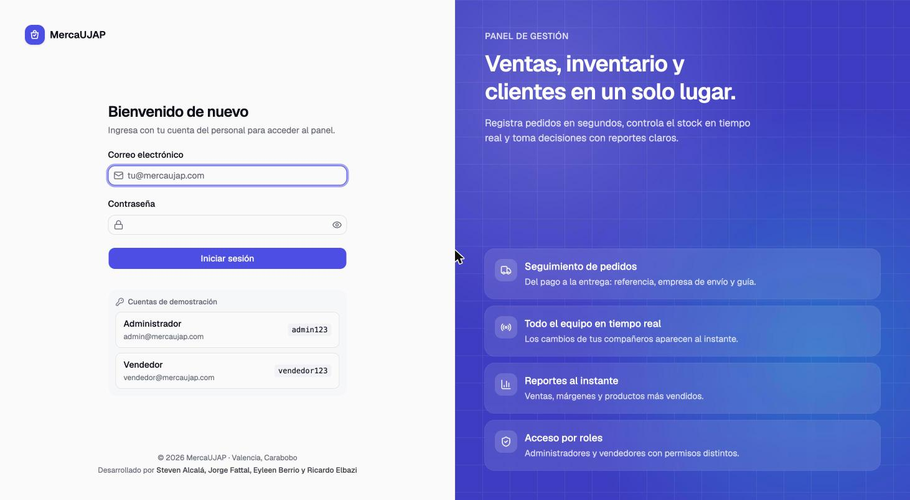 | **Pedidos** 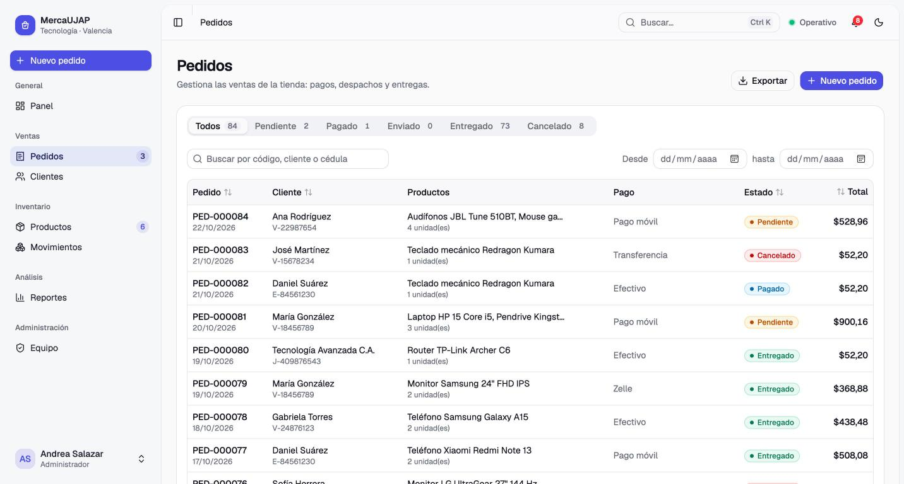 |
| **Detalle de pedido: pago, entrega e historial** 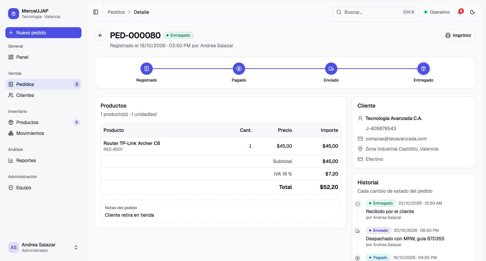 | **Nuevo pedido** 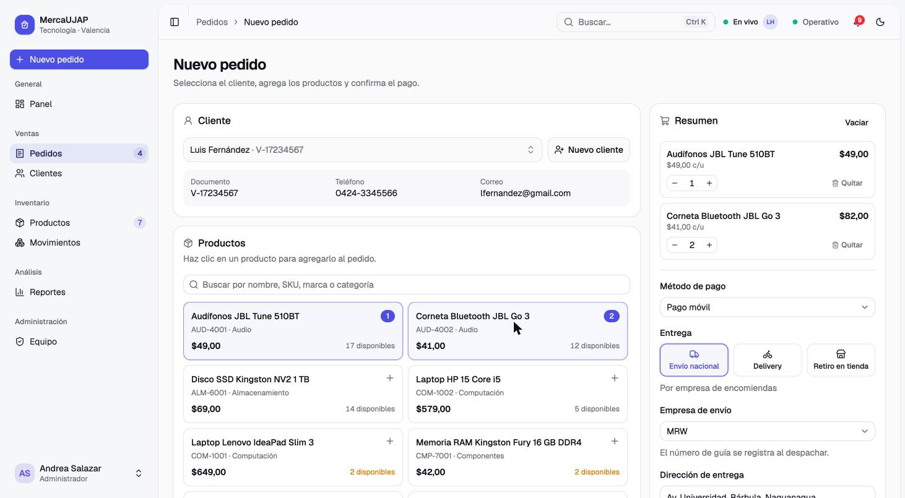 |
| **Registro de pago** 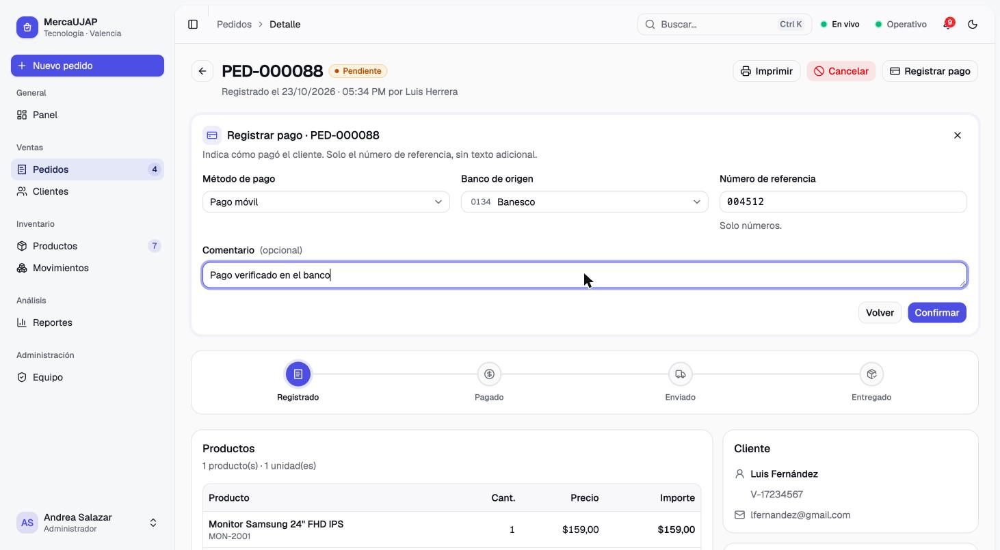 | **Actualización en tiempo real** 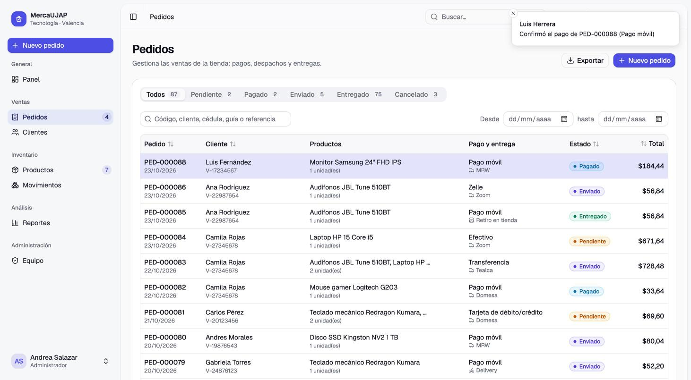 |
| **Productos: detalle y kardex en la tabla** 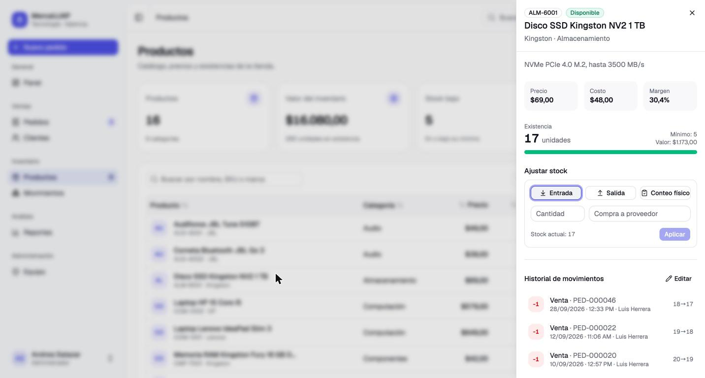 | **Reporte guardado** 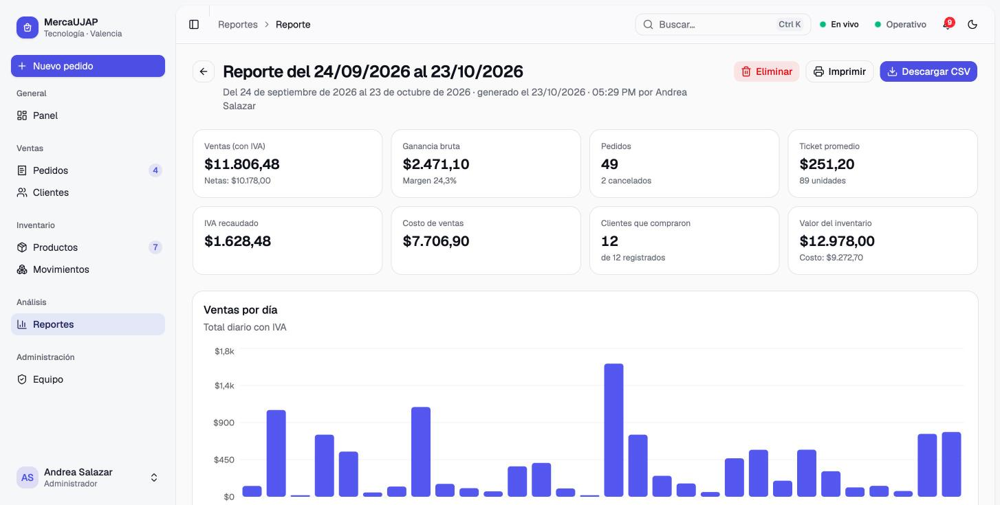 |
| **Tema oscuro** 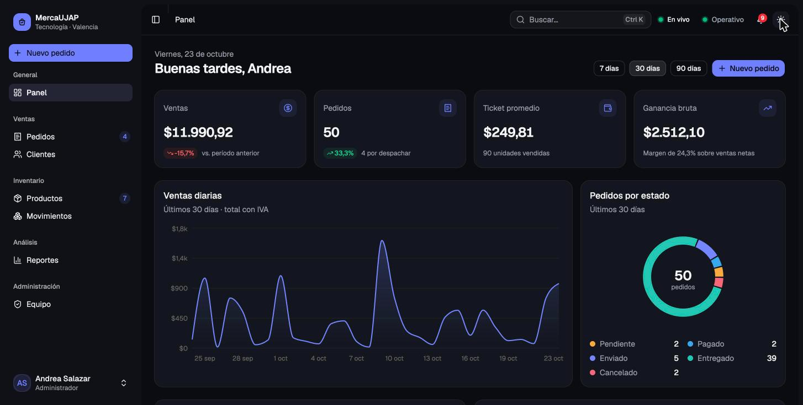 | |

---

## Requisitos del proyecto

| Requisito | Implementación |
|---|---|
| Cuatro microservicios, uno por lenguaje | `servicio-python/` (FastAPI), `servicio-node/` (Express), `servicio-java/` (Spring Boot), `servicio-go/` (Gin) |
| Dockerfile por servicio y `docker-compose.yml` | Dockerfile en cada microservicio, en `frontend/`, `nginx/` y `database/` (construcción multietapa en Java, Go y React); Compose con redes, healthchecks, `depends_on` y volúmenes |
| Base de datos SQL en al menos dos servicios | PostgreSQL en Python (SQLAlchemy), Java (JPA) y Go (GORM) |
| Base de datos NoSQL en al menos un servicio | MongoDB en Node (Mongoose), con las colecciones `productos` y `movimientos` |
| Frontend que consume las APIs | `frontend/`: React con shadcn/ui; consume los cuatro servicios a través del gateway |
| Comunicación entre microservicios | Gateway → Python · Java → Python y Node · Python → Java · Go → Python, Node y Java · Python, Java y Go → Node (eventos) |
| README con diagrama de arquitectura | Este documento |
| API Gateway con Nginx (opcional) | `nginx/nginx.conf`: punto de entrada único en el puerto 8080, enrutamiento, autenticación centralizada, WebSocket, límite de peticiones y errores en JSON |

---

## Estructura del repositorio

```
.
├── docker-compose.yml          # Orquestación de los 8 contenedores
├── docker-compose.debug.yml    # Publica los puertos de cada servicio (desarrollo)
├── .env.example                # Variables de entorno de referencia
├── database/                   # init.sql (una base de datos por servicio) y Dockerfile
├── nginx/                      # nginx.conf (API Gateway) y Dockerfile
├── docs/capturas/              # Capturas de pantalla
├── frontend/
│   └── src/
│       ├── pages/              # Panel, pedidos, productos, inventario, clientes, reportes, equipo
│       ├── components/         # Componentes propios (tablas, formularios, notificaciones…)
│       ├── components/ui/      # Componentes de shadcn/ui
│       ├── hooks/              # use-api (carga de datos con recarga en tiempo real)
│       └── lib/                # Cliente HTTP, sesión, WebSocket y formatos
├── servicio-python/            # main.py, seguridad.py, models.py, schemas.py, database.py
├── servicio-node/              # index.js, tiempo-real.js, producto.model.js, movimiento.model.js
├── servicio-java/              # controller/, service/, model/, repository/, client/, dto/, demo/
└── servicio-go/                # main.go, reportes.go, clientes.go, csv.go, modelos.go, reportes_test.go
```
