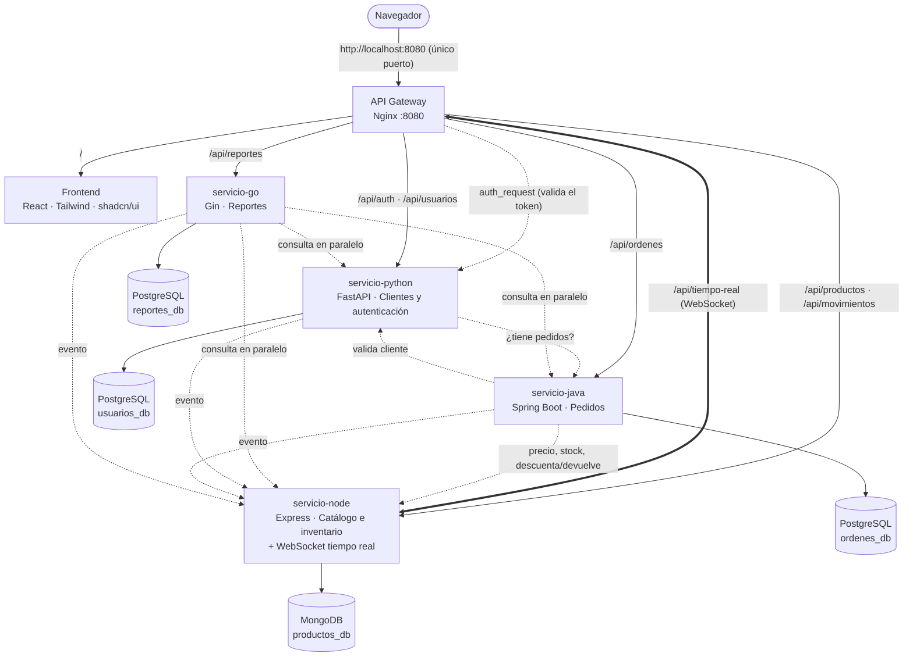

# 🛒 MercaUJAP: sistema de gestión comercial con microservicios

**Proyecto Final · LPR07304 Lenguajes de Programación · Universidad José Antonio Páez**

**Integrantes:** Steven Alcalá · Jorge Fattal · Eyleen Berrio · Ricardo Elbazi

MercaUJAP es el panel de gestión de una **tienda de tecnología**. El personal inicia sesión y desde el navegador puede:

- 🧾 **Registrar pedidos** y llevarlos por su ciclo de vida: *pendiente → pagado → enviado → entregado* (o *cancelado*). Cada paso guarda sus datos en **campos propios**: método de pago, **banco** y **número de referencia** (solo dígitos), forma de entrega (*retiro en tienda*, *delivery* o *envío nacional*), **empresa de envío** (MRW, Zoom, Tealca, Domesa, Liberty Express) y **número de guía**. Cada cambio queda en un historial. Se calcula el IVA (16 %) y se imprime la nota de entrega.
- ⚡ **Trabajar en equipo en tiempo real (WebSocket):** si otra persona crea un pedido, registra un pago, edita un producto o un cliente, la pantalla de los demás se actualiza sola, aparece un aviso con quién lo hizo y la fila cambiada se resalta. Arriba se ve quién está conectado.
- 📦 Administrar el **catálogo**: precios, costos, márgenes y stock mínimo. Cada entrada, salida o ajuste de inventario queda registrado (**kardex**).
- 👥 Gestionar **clientes** (cédula/RIF, contacto, historial de compras).
- 📈 Ver un **panel con indicadores**: ventas, ganancia bruta, ticket promedio y comparación con el período anterior, más gráficos por día, por estado y por categoría. También genera **reportes** que se guardan y se descargan en CSV (Excel).
- 🔐 Controlar el acceso con **inicio de sesión y roles**: el *administrador* puede todo y el *vendedor* no puede eliminar registros.

Cada parte del sistema es un **microservicio** independiente escrito en un lenguaje distinto, con su propio contenedor Docker y su propia base de datos. Todo se levanta con **un solo comando**.

> 📘 ¿Recién empiezas con programación o Docker? Lee la **[GUÍA para entender el proyecto](GUIA.md)**, que explica todo paso a paso.


---

## 🚀 Cómo ejecutarlo

**Requisito:** tener [Docker Desktop](https://www.docker.com/products/docker-desktop/) instalado y abierto. No hace falta instalar Python, Node, Java ni Go, porque todo se compila dentro de Docker.

```bash
git clone https://github.com/stvnalc/mercaujap-microservicios.git
cd mercaujap-microservicios
docker compose up --build
```

La primera vez tarda unos minutos porque descarga imágenes y compila Java, Go y React. Cuando `docker compose ps` muestre los servicios como `healthy`, abre **http://localhost:8080** e inicia sesión:

| Rol | Correo | Contraseña |
|---|---|---|
| Administrador | `admin@mercaujap.com` | `admin123` |
| Vendedor | `vendedor@mercaujap.com` | `vendedor123` |

> El sistema arranca con **datos de ejemplo**: 12 clientes, 16 productos y unos 80 pedidos repartidos en los últimos 60 días, para que el panel y los reportes tengan información desde el primer momento. Se desactiva con `DEMO_DATA=false` en el `.env`.

**Un solo puerto:** el único contenedor que abre un puerto en tu PC es el **API Gateway (8080)**. Desde ahí Nginx reparte cada petición, por la red interna de Docker, al puerto de cada servicio:

| Entra por | El gateway lo envía a |
|---|---|
| http://localhost:8080/ | `frontend:80` |
| http://localhost:8080/api/auth · /api/usuarios | `servicio-python:8000` |
| http://localhost:8080/api/productos · /api/movimientos · /api/tiempo-real (WebSocket) | `servicio-node:3000` |
| http://localhost:8080/api/ordenes | `servicio-java:8080` |
| http://localhost:8080/api/reportes | `servicio-go:8080` |

> Si el 8080 está ocupado en tu PC: `PUERTO=9090 docker compose up --build` (o cambia `PUERTO` en el `.env`).
> Para depurar un servicio directamente (Swagger de Python en `:8001/docs`, etc.): `docker compose -f docker-compose.yml -f docker-compose.debug.yml up --build`.

```bash
docker compose ps                      # estado de cada contenedor (healthy = listo)
docker compose logs -f servicio-java   # logs de un servicio
docker compose down                    # apagar (los datos se conservan)
docker compose down -v                 # apagar y BORRAR los datos (vuelve a cargar los de ejemplo)
```

---

## 🧩 Arquitectura



Versión en texto (por si el diagrama de arriba no se dibuja):

```
                            Navegador (personal de la tienda)
                                          │ http://localhost:8080  (único puerto)
                                          ▼
     ┌────────────────────────────────────────────────────────────────────────┐
     │ API GATEWAY · Nginx :8080 (enrutamiento · auth_request · WebSocket)    │
     └─────┬─────────────┬──────────────┬──────────────┬──────────────┬───────┘
           │ /           │ /api/auth    │ /api/        │ /api/        │ /api/
           │ :80         │ /api/usuarios│ productos    │ ordenes      │ reportes
           │             │ :8000        │ tiempo-real  │ :8080        │ :8080
           │             │              │ :3000        │              │
           ▼             ▼              ▼              ▼              ▼
     ┌───────────┐ ┌────────────┐ ┌────────────┐ ┌────────────┐ ┌────────────┐
     │ FRONTEND  │ │ PYTHON     │ │ NODE       │ │ JAVA       │ │ GO         │
     │ React +   │ │ FastAPI    │ │ Express    │ │ Spring     │ │ Gin        │
     │ shadcn/ui │ │ clientes,  │ │ catálogo,  │ │ pedidos,   │ │ indicado-  │
     │           │ │ login JWT  │ │ inventario │ │ estados    │ │ res y CSV  │
     │           │ │            │ │ WebSocket  │ │            │ │            │
     └───────────┘ └─────┬──────┘ └─────┬──────┘ └─────┬──────┘ └─────┬──────┘
                         ▼              ▼              ▼              ▼
                    PostgreSQL       MongoDB       PostgreSQL     PostgreSQL
                    usuarios_db    productos_db    ordenes_db     reportes_db

  Llamadas entre servicios:  Java → Python (valida cliente) · Java → Node (precio y stock)
                             Python → Java (¿tiene pedidos?) · Go → Python, Node y Java
                             Gateway → Python (valida el token en cada petición)
  Tiempo real:               Python, Java y Go → Node (POST /interno/eventos)
                             Node → navegadores conectados (WebSocket)
```

### 📋 Servicios

| Servicio | Lenguaje / Framework | Puerto | Base de datos · ORM | Responsabilidad |
|---|---|---|---|---|
| **gateway** | Nginx | **`8080`** (único publicado) | — | Punto de entrada único, **autenticación centralizada** (`auth_request`), proxy de **WebSocket**, límite de intentos de login, cabeceras de seguridad y errores en JSON |
| **frontend** | React 19 · Vite · Tailwind CSS 4 · **shadcn/ui** · Recharts | interno `80` | — | Panel de gestión (SPA) |
| **servicio-python** | Python 3.12 · FastAPI | interno `8000` | PostgreSQL · **SQLAlchemy** | Clientes, cuentas del personal, roles, **login con JWT** y contraseñas con hash PBKDF2 |
| **servicio-node** | Node.js 20 · Express · **ws** | interno `3000` | MongoDB · **Mongoose** | Catálogo, SKU, costos/márgenes, stock atómico, **movimientos de inventario** y **canal de tiempo real (WebSocket)** |
| **servicio-java** | Java 21 · Spring Boot 3.5 | interno `8080` | PostgreSQL · **Spring Data JPA** | Pedidos, **máquina de estados**, historial, IVA, pago (banco + referencia), entrega (empresa + guía) y compensación de stock |
| **servicio-go** | Go 1.25 · Gin | interno `8080` | PostgreSQL · **GORM** | Indicadores en vivo, reportes guardados (con ventas por forma de entrega) y **exportación CSV** |
| **postgres** | PostgreSQL 16 | interno | `usuarios_db`, `ordenes_db`, `reportes_db` | Una base de datos por servicio |
| **mongodb** | MongoDB 7 | interno | `productos_db` | Colecciones `productos` y `movimientos` |

### 🔗 Comunicación entre microservicios

| Quién llama | A quién | Para qué |
|---|---|---|
| **Gateway** | Python `GET /auth/verificar` | En **cada** petición protegida: valida el token y el rol, y pasa el usuario a los servicios en cabeceras `X-Usuario-*` |
| Java (pedidos) | Python `GET /usuarios/{id}` | Verificar que el cliente existe y está activo, y copiar sus datos al pedido |
| Java (pedidos) | Node `GET /productos/{id}` | Tomar el precio real y revisar el stock |
| Java (pedidos) | Node `PATCH /productos/{id}/stock` | Descontar stock al vender y devolverlo al cancelar (queda como movimiento `Venta PED-000123`) |
| Python (clientes) | Java `GET /ordenes?usuarioId=` | Impedir que se elimine un cliente que tiene pedidos |
| Go (reportes) | Python, Node y Java **en paralelo** (goroutines) | Calcular los indicadores y reportes |
| Python, Java y Go | Node `POST /interno/eventos` | Avisar cada cambio para reenviarlo **en tiempo real** por WebSocket (ruta solo accesible dentro de Docker) |
| Navegador | Node `WS /tiempo-real` (vía gateway) | Recibir los eventos y la lista de personas conectadas |

**Compensación (patrón saga):** cada servicio tiene su propia base de datos, así que no existe una transacción global. Si al crear un pedido falla el descuento del segundo producto, Java **devuelve el stock** que ya había descontado y borra el pedido.

**Tolerancia a fallos:** si un servicio se cae, el resto sigue funcionando. El gateway responde en JSON y el panel muestra qué módulo no respondió. Si se cae la conexión en tiempo real, el panel muestra *Sin conexión* y se reconecta solo (1 s, 2 s, 4 s… hasta 30 s); al volver, recarga los datos por si hubo cambios.

### ⚡ Tiempo real (WebSocket)

1. Al iniciar sesión, el navegador abre **una** conexión `ws://localhost:8080/api/tiempo-real`. El navegador no permite enviar la cabecera `Authorization` en un WebSocket, así que el token viaja como subprotocolo (`Sec-WebSocket-Protocol: mercaujap, <token>`) y el gateway lo valida con el mismo `auth_request`.
2. Cuando alguien cambia algo, el servicio dueño del dato avisa a Node (`POST /interno/eventos`) y Node lo envía a todos los conectados: `{ tema: "ordenes", accion: "estado", id: 83, mensaje: "Confirmó el pago de PED-000083", usuario: {...} }`.
3. Cada pantalla sabe de qué datos depende (`/productos` → tema `productos`, `/ordenes` → `ordenes`…) y **se recarga sola, sin parpadear**. Si estabas editando ese mismo registro, el formulario te avisa que otra persona lo modificó.

---

## 🔐 Seguridad y reglas de negocio

- **Autenticación centralizada en el gateway:** Nginx usa `auth_request` para preguntarle a Python si el token JWT es válido antes de dejar pasar la petición. Los demás servicios no manejan tokens. Las cabeceras `X-Usuario-*` las escribe siempre Nginx, así que el cliente no puede falsificarlas.
- **Roles:** solo el **administrador** puede eliminar registros (lo aplica el gateway) y gestionar cuentas del personal (lo aplica Python).
- Contraseñas con **hash PBKDF2-SHA256** y sal. Límite de **10 intentos de login por minuto** por IP.
- **Máquina de estados** de pedidos: no se puede pasar de *pendiente* a *entregado*, ni modificar un pedido *entregado* o *cancelado*. Los pedidos con **retiro en tienda** pasan de *pagado* a *entregado* sin el paso *enviado*. Solo se eliminan pedidos cancelados.
- **Datos de pago y envío validados:** pago móvil y transferencia exigen banco (código SUDEBAN) y una referencia **solo numérica**; Zelle, un código alfanumérico; el envío nacional exige empresa y número de guía. Cancelar exige un motivo.
- **Stock atómico:** Node descuenta con `findOneAndUpdate({stock: {$gte: n}}, {$inc: {stock: -n}})`, así que dos ventas simultáneas no pueden dejar el stock negativo.
- Validación de datos en todos los servicios, con **mensajes de error en español**.
- Pruebas unitarias del cálculo de reportes en Go (`go test`), que se ejecutan al construir la imagen.

---

## 🧪 Probar la API desde la terminal

Todas las rutas `/api/*` (salvo el login y los health checks) requieren el token:

```bash
# 1. Iniciar sesión y guardar el token
TOKEN=$(curl -s -X POST http://localhost:8080/api/auth/login \
  -H "Content-Type: application/json" \
  -d '{"email":"admin@mercaujap.com","password":"admin123"}' | python3 -c "import sys,json;print(json.load(sys.stdin)['token'])")

# 2. Usarlo en las peticiones
curl -H "Authorization: Bearer $TOKEN" http://localhost:8080/api/productos
curl -H "Authorization: Bearer $TOKEN" "http://localhost:8080/api/ordenes?estado=PENDIENTE"
curl -H "Authorization: Bearer $TOKEN" "http://localhost:8080/api/reportes/resumen?desde=2026-10-01&hasta=2026-10-31"

# Crear un pedido (Java llama a Python y a Node). Usa un _id real de /api/productos
curl -X POST http://localhost:8080/api/ordenes -H "Authorization: Bearer $TOKEN" -H "Content-Type: application/json" \
  -d '{"usuarioId": 1, "metodoPago": "PAGO_MOVIL", "metodoEntrega": "ENVIO_NACIONAL", "empresaEnvio": "MRW", "items": [{"productoId": "PEGA_AQUI_UN_ID", "cantidad": 2}]}'

# Sin token, el gateway responde 401
curl -i http://localhost:8080/api/productos

# Registrar el pago de un pedido: método, banco y SOLO el número de referencia
curl -X PATCH http://localhost:8080/api/ordenes/1/estado -H "Authorization: Bearer $TOKEN" -H "Content-Type: application/json" \
  -d '{"estado": "PAGADA", "metodoPago": "PAGO_MOVIL", "banco": "0134", "referencia": "004512"}'

# Despacharlo con su empresa de envío y número de guía
curl -X PATCH http://localhost:8080/api/ordenes/1/estado -H "Authorization: Bearer $TOKEN" -H "Content-Type: application/json" \
  -d '{"estado": "ENVIADA", "empresaEnvio": "MRW", "numeroGuia": "7745120"}'
```

<details>
<summary><b>Lista completa de endpoints</b></summary>

| Método | Ruta (vía gateway) | Servicio | Descripción |
|---|---|---|---|
| POST | `/api/auth/login` | Python | Inicia sesión, devuelve `{ token, usuario }` |
| GET | `/api/auth/me` | Python | Usuario del token |
| POST | `/api/auth/cambiar-password` | Python | Cambia la contraseña propia |
| GET | `/api/usuarios?q=&tipo=clientes\|personal&activo=` | Python | Lista con filtros |
| GET/PUT/DELETE | `/api/usuarios/{id}` | Python | Ver, editar o eliminar |
| POST | `/api/usuarios` | Python | Crear cliente o cuenta del personal |
| GET | `/api/productos?q=&categoria=&estado=bajo\|agotado&activo=` | Node | Catálogo con filtros |
| GET | `/api/productos/categorias` | Node | Categorías con valor de inventario |
| GET/PUT/DELETE | `/api/productos/{id}` | Node | Ver, editar o eliminar |
| POST | `/api/productos` | Node | Crear (el stock inicial queda como movimiento) |
| PATCH | `/api/productos/{id}/stock` | Node | Entrada/salida/ajuste `{ cantidad, motivo }` |
| GET | `/api/productos/{id}/movimientos` | Node | Kardex del producto |
| GET | `/api/movimientos?tipo=&q=` | Node | Movimientos de todo el inventario |
| GET | `/api/ordenes?estado=&usuarioId=&desde=&hasta=&q=` | Java | Pedidos con filtros |
| GET | `/api/ordenes/{id}` | Java | Pedido con items, historial y estados siguientes |
| POST | `/api/ordenes` | Java | Crear pedido |
| PATCH | `/api/ordenes/{id}/estado` | Java | `{ estado, nota, metodoPago, banco, referencia, empresaEnvio, numeroGuia, recibidoPor }` según la máquina de estados |
| GET | `/api/ordenes/catalogos` | Java | Métodos de pago, bancos, formas de entrega y empresas de envío |
| DELETE | `/api/ordenes/{id}` | Java | Eliminar (solo cancelados) |
| GET | `/api/reportes/resumen?desde=&hasta=` | Go | Indicadores en vivo |
| GET/POST | `/api/reportes` | Go | Historial / generar y guardar `{ titulo, desde, hasta }` |
| GET/DELETE | `/api/reportes/{id}` | Go | Ver o eliminar un reporte |
| GET | `/api/reportes/{id}/csv` | Go | Descargar en CSV |
| GET | `/api/health/{gateway\|python\|node\|java\|go}` | todos | Estado de cada servicio (público) |
| WS | `/api/tiempo-real` | Node | Eventos en tiempo real y personas conectadas |

</details>

---

## 📸 Capturas

| | |
|---|---|
| **Inicio de sesión**  | **Pedidos**  |
| **Detalle de pedido: pago, entrega e historial**  | **Nuevo pedido: forma y empresa de entrega**  |
| **Productos: detalle y kardex dentro de la tabla**  | **Reporte guardado**  |
| **Registrar pago: banco y referencia**  | **Tiempo real: aviso del cambio de otro usuario**  |

---

## ✅ Cumplimiento de la rúbrica

| Criterio (pts) | Dónde está |
|---|---|
| 4 microservicios, 1 por lenguaje (6) | `servicio-python/`, `servicio-node/`, `servicio-java/`, `servicio-go/` |
| Dockerfile + docker-compose.yml (4) | Un `Dockerfile` en cada microservicio y también en `frontend/`, `nginx/` y `database/` (compilación multi-etapa en Java, Go y React), más `docker-compose.yml` con *networks*, *healthchecks*, *depends_on* y *volumes* |
| BD SQL en mín. 2 servicios (3) | PostgreSQL en **3** servicios: Python (SQLAlchemy), Java (JPA) y Go (GORM) |
| BD NoSQL en mín. 1 servicio (2) | MongoDB en Node (Mongoose), con 2 colecciones |
| Frontend consumiendo las APIs (2) | `frontend/`: React + shadcn/ui, consume los 4 servicios a través del gateway |
| Comunicación entre microservicios (2) | Gateway → Python · Java → Python y Node · Python → Java · Go → Python, Node y Java · Python, Java y Go → Node (eventos) · Node → navegador (WebSocket) |
| README con diagrama (1) | Este archivo |
| **BONUS** API Gateway Nginx (+2) | `nginx/nginx.conf`: **puerto único 8080**, enrutamiento, autenticación centralizada, WebSocket, rate limiting y errores JSON |

---

## 📁 Estructura del repositorio

```
.
├── docker-compose.yml        ← orquesta los 8 contenedores (solo el gateway publica un puerto: 8080)
├── docker-compose.debug.yml  ← opcional: publica el puerto de cada servicio para depurar
├── .env.example              ← variables de entorno (copiar a .env si quieres cambiarlas)
├── README.md · GUIA.md
├── docs/                     ← MercaUJAP-Guia.pdf y capturas de pantalla
├── database/                 ← init.sql (una BD por servicio) + Dockerfile
├── nginx/                    ← nginx.conf (API Gateway) + Dockerfile
├── frontend/                 ← React + Vite + Tailwind + shadcn/ui
│   └── src/
│       ├── components/ui/    ← componentes de shadcn/ui (botones, tablas, diálogos…)
│       ├── components/       ← barra lateral, buscador, tablas, insignias…
│       ├── pages/            ← panel, pedidos, productos, clientes, reportes, equipo
│       └── lib/              ← api.js (llamadas al gateway), tiempo-real.jsx (WebSocket), auth, formatos
├── servicio-python/          ← main.py, seguridad.py, models.py, schemas.py, database.py
├── servicio-node/            ← index.js, tiempo-real.js (WebSocket), producto.model.js, movimiento.model.js
├── servicio-java/            ← controller/, service/, model/, repository/, client/, demo/
└── servicio-go/              ← main.go, reportes.go, csv.go, clientes.go, modelos.go, reportes_test.go
```
